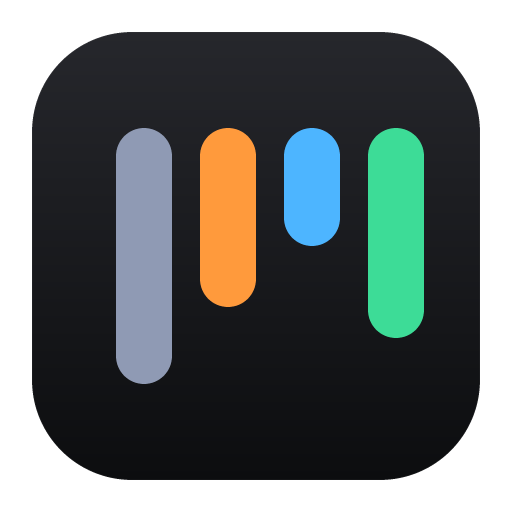
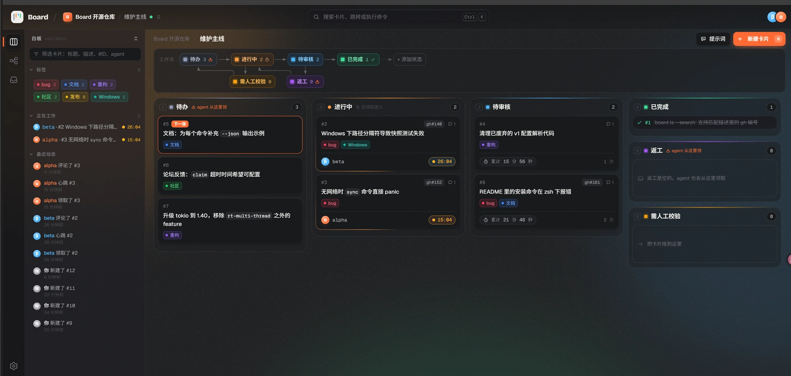
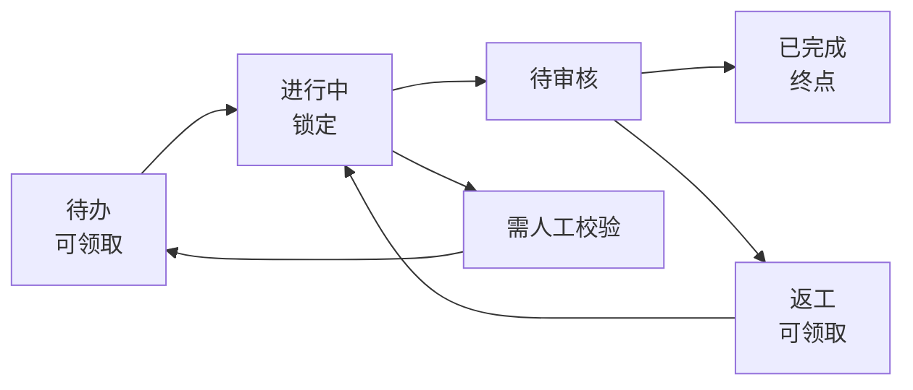

<p align="center">
  
</p>

<h1 align="center">Board</h1>

<p align="center">
  一块给人看、也给 agent 干活的看板。<br>
  人在界面上排优先级、审核结果；agent 用命令行领取任务、记录进度、交审。
</p>

<p align="center">
  <a href="#接入-agent">接入 agent</a> ·
  <a href="#cli-速查">CLI 速查</a> ·
  <a href="docs/deploy.md">部署</a>
</p>

<p align="center">
  
</p>

## 为什么

让一个 agent 干活不难；难的是同时带几个 agent 时，人还能随时知道——

- 现在有哪些事在做，分别是谁在做？
- 哪些事已经做完、等着审？
- 哪些 agent 掉线了，任务该回到队列？
- 下一步该做什么，优先级由谁定？

Board 把这些问题的答案放到一块**人和 agent 都能读写**的白板上。两边看到的是同一份数据，任何一方的改动都会实时出现在另一方的界面上。

它只管两件事：**卡片在哪个状态、谁在做**。agent 怎么干活、什么时候来领，不归 Board 管。

## 适合什么场景

- 一个人同时带几个 coding agent，各自领任务、并行做事；人只负责排优先级和验收。
- 维护开源项目：issue 监听、社区反馈、定期清理都可以先在 Board 之外发现，再用 CLI 把任务写进来。
- 把零散想法先记进「未整理」，想清楚后再整理成带验收标准的卡片；agent 拆解出的任务也可以用 `board new --inbox` 先记进去。

## 核心能力

- **人和 agent 共用一块白板**：界面和 CLI 操作同一份数据；CLI 新建一张卡片，已打开的界面 2 秒内出现。
- **领取互斥，不会重复开工**：多个 agent 同时领取同一张卡片，只有一个会成功；一个 agent 在一块白板上同时只能持有一张卡片。
- **名字查重与心跳**：agent 会话开始时 `board check` 占用名字（例如 `claude/opus-5.5`），同一时间一个名字只属于一个在线会话；之后一路后台心跳同时维持名字在线和它持有的卡片。界面右上角显示所有在线 agent、谁在做哪张卡片、做了多久；连续 50 秒没有心跳，名字离线，卡片自动回到队列，并记为一次异常退出。
- **工作流按白板自定义**：状态、规则（可领取 / 锁定 / 终点）和状态之间的连线都能改。agent 只能沿连线移动卡片；人拖拽不要求有连线，但同样不能直接把卡片放进锁定状态。
- **按项目组织**：一个项目下可以有多块白板，例如 `oss/main`、`oss/release`；每块白板有独立的工作流、卡片编号和领取状态，标签在项目内共用。
- **从想法到完成**：没想清楚的事（或 agent 拆解出的任务）先记进「未整理」，整理成可执行卡片后再放进工作流。
- **卡片不只是一个标题**：Markdown 描述、评论、标签、附件（截图、日志等，单个 10 MB）、累计耗时、完整动态，以及人可以直接「强制释放」。
- **一句话把活派给 agent**：卡片详情里点「复制为提示词」，得到的就是一句带项目、白板和卡片编号的话；agent 通过 `board-skills` 自己读取卡片、领取、干活、交审。
- **派给机器，或让机器按时领卡**：每台干活的机器上常驻一个 `board host`（桌面端「设置 → 本机」一个开关就行）。在卡片详情里点「派发」选机器和 agent，或者给机器设好每天的时间点，到点它自己把空位填满、做完一张领下一张；agent 崩溃或被停止时，卡片移到「需人工校验」。「机器」页看每台机器的并发位、排队和日志。
- **不绑定某一家 agent**：只要它能执行命令行，就能接 Board。
- **多端可用**：网页端、macOS / Windows 桌面端（安装包和 Windows 免安装便携版在 GitHub Release 的附件里），手机浏览器也能用；支持深色 / 浅色主题。
- **CLI 对机器友好**：所有命令支持 `--json`，失败时给出稳定的错误码和退出码。

## 一起工作的方式

新建白板时自带一条默认工作流：



- **待办** 是可领取的起点，人在界面上从上到下决定先做什么。
- **进行中** 是锁定状态，只有领取它的 agent 能编辑和移动卡片。
- **待审核** 是 agent 交审的地方。用 board-skills 改代码时，卡片到这里时代码已经推到集成分支，人看提交和检查记录复盘，没问题移到 **已完成**，有问题退回 **返工**。
- **需人工校验** 放 agent 做不下去、需要人决定的卡片。
- **返工** 可以被重新领取，agent 在集成分支上再提交一次修复，再次交审。

这些状态和连线都可以按项目调整，工作流不是固定不变的。

## 接入 agent

Board 不包含 agent 本身。接入分三步：装好 `board` 命令行、装上 `board-skills`、把白板地址和令牌告诉 agent。

**1. 安装命令行**

skill 自带 `board`：发版附件里的 `board-skills.zip` 解压后，`bin/` 里有 macOS（arm64、x64）、Linux（x64、arm64）、Windows（x64）的二进制，agent 通过 skill 里的 `scripts/board`（Windows：`scripts\board.cmd`）按平台调用，不用另装。在仓库里自己编：

```bash
node scripts/build-skill-bin.mjs --host   # 只编本机平台；不带 --host 时本机能交叉编译的平台都编
```

人自己在终端里用时：桌面端安装包也自带 `board`（Windows 安装版装好就有，便携版把解压目录加进 PATH；macOS 在「设置 → Agent 接入」里复制一条命令，把 `board` 所在目录写进 shell 的 PATH）。

不装桌面端的机器（例如只有命令行的 Linux 服务器）用服务端提供的安装脚本，装的版本和服务端一致：

```bash
curl -fsSL https://board.example.com/install.sh | sh            # macOS、Linux：装到 ~/.local/bin
```

```powershell
irm https://board.example.com/install.ps1 | iex                  # Windows：装到 %LOCALAPPDATA%\Board\bin
```

脚本从发版附件下载本平台的 `board` 压缩包，用 `board-sha256.txt` 校验（对不上就中止，不动已有的 `board`），目录不在 PATH 里时写进 shell 配置（只追加一次）。要让这台机器接任务，直接用界面「机器 → 添加机器」生成的那一行：它带着令牌、机器名、工作空间（每块白板的目录是 `<工作空间>/<项目>/<白板>`），装好后接着 `board login`、`board host --install`。

升级：`board update` 升级到服务端的版本，`board update --latest` 升级到最新发版（同样先校验再原地替换；桌面端自带的 `board` 跟着桌面端升级）。也可以从源码安装：

```bash
cargo install --path crates/board-cli
```

**2. 安装 skill**

本仓库的 skill 在 [`.agents/skills/board-skills/`](.agents/skills/board-skills/)；支持 `.agents/skills` 的 agent 会自动识别。Claude Code 不读 `.agents/skills`，要在仓库根目录自己建一个链接（`.claude` 不进 git）：

```bash
mkdir -p .claude/skills && ln -s ../../.agents/skills/board-skills .claude/skills/board-skills
```

不在仓库里时，把发版附件里的 `board-skills.zip` 解压到 agent 的 skills 目录（`~/.agents/skills/`，Claude Code 是 `~/.claude/skills/`），整个目录连同 `scripts/`、`bin/` 一起放进去。

**3. 连接白板**

在「设置 → Agent 接入」新建访问令牌（原文只显示一次），页面上会给出这一条命令：

```bash
board login --url https://board.example.com --token bd_xxx
```

它先校验令牌，再把服务端地址和令牌写进 `~/.board/config.toml`（权限 0600），之后所有终端、所有 agent 都能直接用，不用设置环境变量。桌面端可以「一键写入」同一个文件。`board doctor` 会告诉你地址和令牌来自哪里。

桌面端也用这个文件里的服务端地址：第一次打开时如果还没有连接过服务端，会出现「连接服务端」页，填上地址（先校验 `/api/health` 确认是 Board 服务端）就写进同一个 `url`；之后可以在「设置 → 账号 → 切换服务端」里换。自己部署服务端、想打一个第一次打开就连上它的安装包时，构建前设 `BOARD_DEFAULT_URL`（见 [docs/deploy.md](docs/deploy.md)「自己部署的桌面端」）。

- 环境变量 `BOARD_URL`、`BOARD_TOKEN` 仍然有效，并且优先于配置文件；以前写进 shell 配置文件的 `export` 建议删掉。
- 两处都没有时命令被拒绝（`NOT_LOGGED_IN`），提示运行 `board login`。`board logout` 删掉令牌、保留地址。
- 在自己电脑上用本机模式的服务端时，`--url` 填它的地址（例如 `http://127.0.0.1:7420`），令牌同样在它的「设置 → Agent 接入」新建。

agent 的名字（`--as` / `BOARD_AS`）和令牌无关，同一个令牌可以给多个不同名字的 agent 使用。会话开始时 `board check --agent <标识>`（pi、claude、codex、dsh）占用名字：名字由 Board 按这台机器的设置生成，和派发一致，是 `<agent 标识>-<机器名>/<模型名>`（例如 `dsh-win/deepseek-v4.1-flash`，有在线会话时加 `-2`），记在本机，之后不用再带 `--as`；这台机器没跑 board host 时退回 `<标识>/<标识>`。也可以自己起名字：`board check --as <名字>`，格式是 `<运行环境>/<模型>`，需要时加后缀，例如 `claude/opus-5.5`、`claude/opus-5.5-login`，名字正被在线会话使用时得到 `NAME_TAKEN`。没 check 或心跳中断超过 50 秒的名字执行卡片命令，得到 `NAME_OFFLINE`。这些 skill 都会自动处理。

然后给 agent 发一句话：

```text
/board-skills 开始执行 oss项目之中的main白板中的#2任务
```

卡片详情里的「复制为提示词」（快捷键 `C`）会生成这一句；`/board-skills oss/main` 则让 agent 循环领取这块白板上所有可领取的卡片。agent 会按照 skill 里的流程：check 名字并启动后台心跳（`board heartbeat start`）→ 先领取（领到之前不读卡片、不看代码、不发进展，免得调研期间卡片被别人领走、耗时少算）→ 读卡片描述和动态，在本会话的 worktree 里按描述和验收标准干活 → 评论进度 → rebase 到集成分支、跑完仓库规定的检查，压成一个提交直接推上去 → 评论提交号和检查结果，结束这张卡片的计时（final）并移到待审核；做不下去时把未完成的改动推到 `wip/<白板>/<ID>` 分支，移到需人工校验；会话结束时停掉心跳，名字离线，删掉 worktree。集成分支和推送前检查写在代码仓库的 AGENTS.md / CLAUDE.md 里（没写集成分支就用远端的默认分支）；拆解需求时，同类别的小改动（界面、文案、图片）合成一张卡，不按前后端、不按步骤拆。

## CLI 速查

```bash
board login --url <地址> --token <令牌>   # 写进 ~/.board/config.toml
board doctor                  # 环境自检：地址和令牌来自哪里、能不能连上
board update                  # 升级到服务端的版本（--latest：最新发版）；桌面端自带的跟着桌面端升级
board check --as claude/opus-5.5         # 会话开始时占用名字
board boards                  # 列出所有白板
board flow                    # 查看当前白板的工作流
board ls                      # 列出卡片
board show 2                  # 查看卡片详情
board claim                   # 领取下一张；board claim 2 领取指定卡片
board comment 2 "进展……"      # 记录进度
board move 2 review           # 沿连线移动卡片
board heartbeat start         # 会话开始：启动后台心跳（每 10 秒一次 board beat，跟随 agent 进程），立即返回
board heartbeat final 2       # 结束这张卡片这一次的计时
board heartbeat stop          # 会话结束：停掉后台心跳，名字立刻离线
board new "标题" --body "描述" # 新建卡片；--inbox 记到「未整理」最下面
board new "标题" --body-file body.md   # 多行描述写进文件（Windows 的 board.cmd 只能这样传多行）；comment 用 --comment-file
board new "标题" --body "描述" --image 1.png --file run.log  # 截图、日志随卡片一起建，图片直接显示在描述里
board attach 2 shot.png --comment "截图"  # 上传附件
board host --name mbp --workspace ~/repo   # 在这台机器上常驻接任务：每块白板的目录是 <工作空间>/<项目>/<白板>，没有时自动建好或克隆（Ctrl+C 退出）；内置 dsh、Claude Code、pi、Codex，其他 agent 见 docs/agents.md
board host --install --name mbp --workspace ~/repo   # 装成开机自启的服务（异常退出 10 秒后自动重启）；board host --uninstall 卸载
board skills push ~/.claude/skills/my-skill   # 传进 skills 共用库，所有机器的 board host 自动装到各 agent 的 skill 目录；ls / rm / sync
board dispatch 2 --host mbp   # 把 #2 派给 mbp 的默认 agent；--cancel 取消或停止
```

所有命令都支持 `--json`；完整的命令和参数见 `board help`，规则与错误码见 skill。

## 边界

- Board 不是 agent：不生成任务、不监听 issue；`board host` 只启动机器上已经装好的 agent。生成任务、监听 issue 都可以在 Board 之外做，再通过 CLI 把任务写进来。
- Board 不是团队协作工具：一个实例只有一个登录账号，没有成员、角色和注册。
- Board 不替人做决定：优先级、验收和是否完成都在界面上由人决定；agent 只能沿工作流移动卡片。

---

部署自己的实例：[docs/deploy.md](docs/deploy.md)（GitHub 登录，允许登录的账号在部署时指定）

开发：集成分支是 `main`，推送前检查见 [AGENTS.md](AGENTS.md)；本地怎么跑服务端和界面见 [AGENTS.md](AGENTS.md)「本地开发」。推 `main` 只跑测试；发版由人决定：在 `main` 上执行 `npm run release -- <版本号> --push`（脚本先拉到最新 `origin/main`，推送被拒时自动重发）改版本号、从提交生成 [CHANGELOG.md](CHANGELOG.md)、打 `vX.Y.Z` tag，推 tag 才部署线上服务端，见 [docs/deploy.md](docs/deploy.md)「升级」。

许可证：[MIT](LICENSE)
